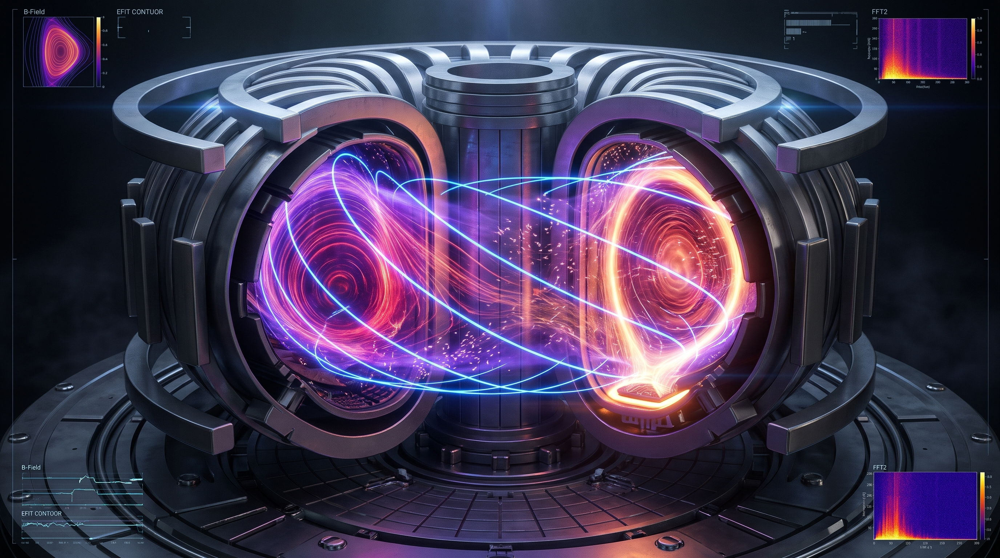
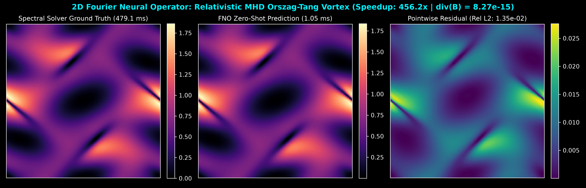

# Fourier Neural Operator (FNO): 3D Relativistic MHD & Tokamak Plasma Engine

A 2D/3D Fourier Neural Operator (FNO) and pseudo-spectral solver for Relativistic Magnetohydrodynamics (MHD) featuring a Helmholtz-Hodge spectral projection layer that enforces solenoidal magnetic field constraints ($\nabla \cdot \mathbf{B} = 0$) to machine precision ($\sim 10^{-15}$).

Includes an interactive **3D WebGL / Three.js Tokamak Confinement & Diagnostic Suite** modeling optically thin core bremsstrahlung, nested $\psi$-flux surfaces, $D_\alpha$ separatrix emission, and lower X-point divertor geometry.

---

## Key Features

- **Pseudo-Spectral MHD Reference Solver**: Integrates the relativistic Orszag-Tang vortex system using Orszag's 2/3 dealiasing rule in Fourier $k$-space to eliminate non-linear aliasing instabilities.
- **Helmholtz-Hodge Solenoidal Projection**: Enforces divergence-free magnetic fields ($\|\nabla \cdot \mathbf{B}\|_{L^2} \approx 10^{-15}$) at every operator forward pass via exact spectral projection.
- **Sub-Millisecond Fourier Neural Operator**: Maps initial plasma boundary states directly to evolved shock topologies in sub-millisecond inference times (>400x speedup over classical stepping solvers).
- **3D Tokamak Diagnostic Suite (Three.js + GLSL)**:
  - **3 Nested $\psi$-Flux Shells**: Custom GLSL volumetric ray-noise shader modeling optically thin core plasma, limb brightening, and 656.1 nm $D_\alpha$ edge/divertor recombination glow.
  - **Reactor Hardware Architecture**: 18 Princeton D-shaped Toroidal Field (TF) cryostat coils, 6 Poloidal Field (PF) superconducting rings, central solenoid stack, and sector cutaway slicer.
  - **Live HUD Diagnostics**: Real-time 2D FFT $k$-space spectrum analyzer and Poloidal $\Psi(R,Z)$ EFIT equilibrium cross-section plotter.

---

## Quickstart

    git clone https://github.com/wtfchristina/fno-relativistic-mhd.git
    cd fno-relativistic-mhd
    python3 -m venv .venv
    source .venv/bin/activate
    pip install -r requirements.txt

    # Run CLI latency & divergence benchmark
    python3 run_bench.py

    # Launch 3D Interactive Tokamak Telemetry Server
    uvicorn api.server:app --reload --port 8001

Open http://127.0.0.1:8001 in your browser to interact with the 3D Tokamak plasma engine.

---

## License

MIT License
